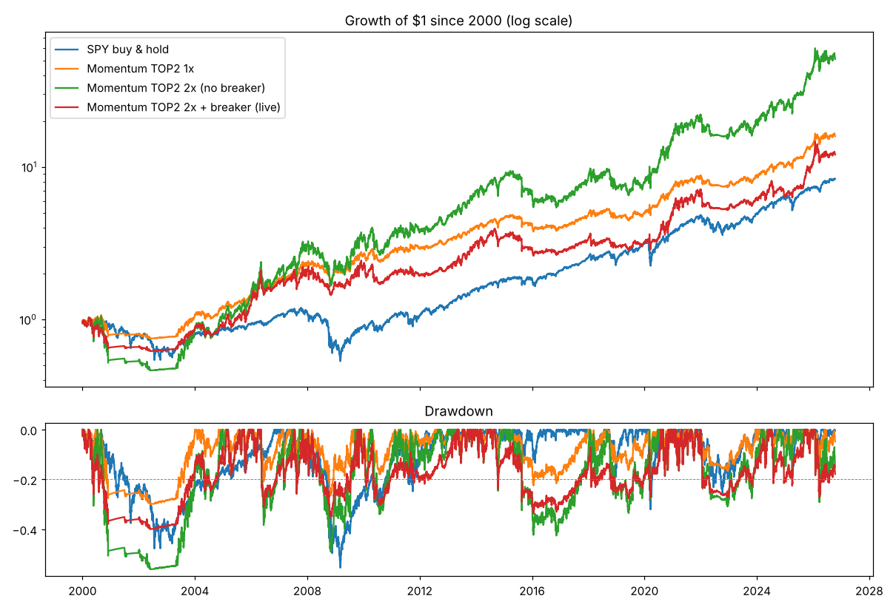

# Noire 研究报告 v1：长周期回测（数据 1993-01-29 ~ 2026-10-14）

> 只做研究，不改实盘参数。所有数字是历史模拟，不代表未来。
> 各 ETF 上市日：SPY 1993-01-29，QQQ 1999-03-10，IWM 2000-05-26，EFA 2001-08-27，EEM 2003-04-14，TLT 2002-07-30，GLD 2004-11-18，SHY 2002-07-30
> “2000至今”区间里，早期只有 SPY（以及之后上市的 QQQ、IWM…）可选，其余时间拿现金；“全标的可用后”从 2005-12-23 开始，7 只 ETF 都能参与。

成本假设：单边 0.10%；借款利率 = 13 周国库券利率 + 1.5%；熔断 = 回撤 >20% 降到 1 倍、<10% 恢复；追缴 = 净值/持仓 < 30%。

## 结论（Claude 写，2026-10-15；19:55 补充 A+；20:30 用最新数据重算；10-16 补充修正说明）

**一句话：策略本身站得住，但现在的“2倍+熔断”组合有问题——历史上它比不加杠杆的 1 倍还差。**
建议把“亏了才降杠杆”的熔断，换成“动荡时提前降杠杆”的波动目标，最好再加趋势开关（A+）。改不改由用户决定；本研究不改实盘。

> 第二轮搜索（`report_v2.md`）又试了约 60 种改法，没有找到明显更赚钱的；唯一值得的升级是“A+ 稳健版”
> （分 4 批换仓 + 波动小的多买，10-15 已上线）：平均收益和 A+ 差不多，但不靠换仓日运气、最坏情况好得多。详见 report_v2.md
> （10-16 修正：稳健版的平均最大回撤约 -39%，之前写的 -36% 偏乐观）。风险预期见 `expectations.md`，第二条腿见 `report_v3.md`。

### 1. 现行设置的问题：熔断等于“在低点卖出”
- 2000 年至今：现行 2倍+熔断 年化 9.9%、最大回撤 -39.9%、最差一年 -32%；不加杠杆的 1 倍是 11.0%、-29.9%、-19%。三项全输。
- 原因：亏到 -20% 才降到 1 倍，这时往往已经接近底部；之后要靠 1 倍慢慢爬回到离最高点 10% 以内才恢复 2 倍。
  2000 年以来约 2/3 的交易日（4526 天）都卡在熔断里，反弹的钱没赚到。
- 加“熔断满 6 个月自动解除”能好一点（12.2%），但还是不如 1 倍划算。

### 2. 更好的安全阀：波动目标
- 做法：每天看当前持仓最近 3 个月的波动幅度；市场平静时用到 2 倍，越动荡杠杆越低，最低 1 倍。
  它在暴跌**开始时**就降杠杆，而不是亏完才降。这是学术界和基金常用的做法。
- 2000 年至今，目标 25%：年化 13.4%、最大回撤 -42.7%、最差一年 -25%、平均杠杆 1.67 倍。
  金融危机期间 -11%（固定 2 倍是 -25%），互联网泡沫破裂期间 -34%（固定 2 倍是 -54%）。
- 目标 18%/20% 更稳：年化 12.1–12.3%、最大回撤 -34%~-37%、最差一年 -21%~-22%，三项都好过现行设置。
- 目标从 18% 调到 30%，收益和回撤是平滑变化的，不是“碰巧挑中一个好数字”。
- 波动目标再叠加熔断反而变差（11.9%）→ 建议**取代**熔断，而不是叠加。
- **再加“趋势开关”更好（A+）**：只有“市场平静”且“SPY 在 200 日均线上方”时才加杠杆，两个条件取较低的杠杆。
  波动目标 30% + 趋势开关：年化 14.6%、最大回撤 -39.6%、最差一年 -23%、平均杠杆 1.67 倍，三项都好过单用波动目标 25%。
  换 7 个不同的换仓日各算一遍：加趋势开关每次都让最大回撤变小（少 3~9 个百分点），收益基本不变（±0.7%）；平均下来 A+ 也好过 A（第 9 节）。
- 更多改法（持有前 3 名、扩大可选范围、换动量算法、金丝雀信号等）见 report_v2.md，都没有明显更好。

### 3. 别把历史数字当承诺
- **换仓日运气**：同一个策略，只是把换仓日从月末挪到月末前几天，1 倍年化就在 9.1%~12.3% 之间变动，而月末（12.2%）恰好是最好的几天之一。
  平均约 10.8%，和同期 SPY（11.1%）差不多。所以这个策略的真本事是**回撤只有大盘的一半左右**（-26% 对 -55%），而不是 1 倍下比大盘赚得多。
  杠杆正是把“风险小”换成“收益高”。
- **可能连续多年跑输大盘**：2010–2019 年 SPY 年化 13.3%，策略 1 倍只有 6.4%，现行设置 3.6%。要有心理准备。
- **不要频繁调参数**：每年自动挑“过去 5 年最好的参数”，结果反而更差（9.8%，固定参数是 12.5%）。保持简单固定的规则。
- 所有方案在历史上都没有触发过追缴保证金（2 倍时持仓要单日跌约 29% 才会追缴）。2 倍的真正风险是深度回撤，不是爆仓。
- 真钱的借钱成本更高：Alpaca 保证金利率 6.5%，比国库券高约 2.5 个百分点（研究默认 1.5）。按 2.5 算，A+ 每年少约 0.7 个百分点（见 report_v2.md D 节）。

### 4. 可选方案（等用户决定；只算月末换仓，2000 至今）

| 选项 | 年化 | 最大回撤 | 最差一年 | 说明 |
|---|---|---|---|---|
| A+. 波动目标 30% + 趋势开关，杠杆 1~2 倍（推荐，或其“稳健版”） | 14.6% | -39.6% | -23.4% | 平静且上涨趋势时才加杠杆 |
| A. 波动目标 25%，杠杆 1~2 倍 | 13.4% | -42.7% | -25.4% | 动荡时提前降杠杆 |
| B. 固定 2 倍，去掉熔断 | 16.0% | -56.0% | -43.8% | 最激进；2000–2002 年会亏掉一半以上 |
| C. 1 倍 | 11.0% | -29.9% | -19.1% | 最稳 |
| D. 保持现状（2 倍+熔断） | 9.9% | -39.9% | -32.0% | 不推荐 |

（数据到 2026-10-14 的历史模拟，已扣交易成本和借钱利息。月末换仓是历史上运气较好的一天；7 个换仓日平均的对比见 report_v2.md。）

无论选哪个都保留：单日亏损 5% 只卖不买、STOP 紧急停止、保证金和杠杆报警。

---

# 附：全部数据

## 1. 总表（2000至今）

| 方案 | 年化 | 最大回撤 | 夏普 | 最差一年 | 最长套牢(月) | 追缴次数 | 熔断天数 |
|---|---|---|---|---|---|---|---|
| SPY 一直持有 | 8.4% | -55.4% | 0.42 | -36.8% | 74.00 | 0 | 0 |
| SPY 2倍 | 9.1% | -89.0% | 0.37 | -67.7% | 176.57 | 0 | 0 |
| SPY 2倍+熔断 | 8.9% | -59.6% | 0.40 | -36.8% | 88.00 | 0 | 4378 |
| 轮动TOP1 1倍 | 9.6% | -33.5% | 0.45 | -19.7% | 66.62 | 0 | 0 |
| 轮动TOP1 1.5倍 | 10.9% | -49.7% | 0.43 | -35.1% | 70.86 | 0 | 0 |
| 轮动TOP1 1.5倍+熔断 | 9.2% | -41.0% | 0.40 | -29.1% | 71.14 | 0 | 4678 |
| 轮动TOP1 2倍 | 10.8% | -64.6% | 0.41 | -49.8% | 71.71 | 0 | 0 |
| 轮动TOP1 2倍+熔断 | 8.0% | -41.0% | 0.35 | -32.5% | 67.00 | 0 | 5512 |
| 轮动TOP1 2倍+熔断(6个月重置) | 7.7% | -60.4% | 0.33 | -33.6% | 131.05 | 0 | 3126 |
| 轮动TOP2 1倍 | 11.0% | -29.9% | 0.61 | -19.1% | 39.76 | 0 | 0 |
| 轮动TOP2 1.5倍 | 13.9% | -44.1% | 0.58 | -31.8% | 50.10 | 0 | 0 |
| 轮动TOP2 1.5倍+熔断 | 11.1% | -37.0% | 0.51 | -29.6% | 55.52 | 0 | 2843 |
| 轮动TOP2 2倍 | 16.0% | -56.0% | 0.56 | -43.8% | 51.38 | 0 | 0 |
| 轮动TOP2 2倍+熔断 | 9.9% | -39.9% | 0.44 | -32.0% | 70.90 | 0 | 4526 |
| 轮动TOP2 2倍+熔断(6个月重置) | 12.2% | -45.7% | 0.49 | -32.0% | 44.95 | 0 | 1708 |
| 轮动TOP3 1倍 | 10.3% | -22.5% | 0.64 | -17.6% | 37.05 | 0 | 0 |
| 轮动TOP3 1.5倍 | 13.1% | -34.4% | 0.60 | -25.1% | 39.48 | 0 | 0 |
| 轮动TOP3 1.5倍+熔断 | 11.3% | -29.5% | 0.56 | -23.0% | 39.48 | 0 | 2484 |
| 轮动TOP3 2倍 | 15.4% | -44.8% | 0.59 | -32.1% | 39.76 | 0 | 0 |
| 轮动TOP3 2倍+熔断 | 9.1% | -33.3% | 0.42 | -25.8% | 46.14 | 0 | 3827 |
| 轮动TOP3 2倍+熔断(6个月重置) | 12.4% | -40.4% | 0.52 | -27.6% | 46.19 | 0 | 1417 |

## 1. 总表（全标的可用后）

| 方案 | 年化 | 最大回撤 | 夏普 | 最差一年 | 最长套牢(月) | 追缴次数 | 熔断天数 |
|---|---|---|---|---|---|---|---|
| SPY 一直持有 | 11.1% | -55.4% | 0.57 | -36.8% | 58.19 | 0 | 0 |
| SPY 2倍 | 15.0% | -84.7% | 0.52 | -67.7% | 72.52 | 0 | 0 |
| SPY 2倍+熔断 | 12.1% | -61.1% | 0.53 | -40.2% | 66.76 | 0 | 2598 |
| 轮动TOP1 1倍 | 10.4% | -28.8% | 0.50 | -15.6% | 66.62 | 0 | 0 |
| 轮动TOP1 1.5倍 | 12.2% | -43.6% | 0.47 | -22.9% | 70.86 | 0 | 0 |
| 轮动TOP1 1.5倍+熔断 | 10.0% | -36.7% | 0.44 | -23.0% | 71.14 | 0 | 3545 |
| 轮动TOP1 2倍 | 12.7% | -59.8% | 0.46 | -30.4% | 71.71 | 0 | 0 |
| 轮动TOP1 2倍+熔断 | 9.7% | -37.3% | 0.42 | -20.9% | 67.00 | 0 | 4183 |
| 轮动TOP1 2倍+熔断(6个月重置) | 9.0% | -60.4% | 0.38 | -25.9% | 131.05 | 0 | 2471 |
| 轮动TOP2 1倍 | 12.2% | -26.3% | 0.69 | -14.0% | 32.24 | 0 | 0 |
| 轮动TOP2 1.5倍 | 15.9% | -38.4% | 0.66 | -20.4% | 33.67 | 0 | 0 |
| 轮动TOP2 1.5倍+熔断 | 12.6% | -32.5% | 0.58 | -20.2% | 33.95 | 0 | 1967 |
| 轮动TOP2 2倍 | 18.8% | -49.0% | 0.64 | -26.6% | 33.90 | 0 | 0 |
| 轮动TOP2 2倍+熔断 | 11.5% | -35.3% | 0.51 | -24.2% | 70.90 | 0 | 3400 |
| 轮动TOP2 2倍+熔断(6个月重置) | 13.4% | -37.2% | 0.53 | -24.5% | 40.00 | 0 | 1411 |
| 轮动TOP3 1倍 | 11.4% | -21.9% | 0.71 | -17.6% | 31.71 | 0 | 0 |
| 轮动TOP3 1.5倍 | 14.8% | -32.0% | 0.67 | -25.1% | 35.05 | 0 | 0 |
| 轮动TOP3 1.5倍+熔断 | 12.5% | -29.5% | 0.61 | -23.0% | 35.48 | 0 | 1758 |
| 轮动TOP3 2倍 | 17.7% | -41.5% | 0.66 | -32.1% | 39.00 | 0 | 0 |
| 轮动TOP3 2倍+熔断 | 10.5% | -32.4% | 0.48 | -25.8% | 46.14 | 0 | 2820 |
| 轮动TOP3 2倍+熔断(6个月重置) | 14.1% | -37.0% | 0.58 | -27.6% | 46.19 | 0 | 1131 |

## 2. 几次大跌期间的表现（2000至今区间）

| 方案 | 互联网泡沫破裂 2000-03~2002-10 | 金融危机 2007-10~2009-03 | 新冠暴跌 2020-02~03 | 2022 熊市 2022-01~10 |
|---|---|---|---|---|
| SPY 一直持有 | -47.6% | -54.1% | -30.2% | -26.3% |
| SPY 2倍 | -79.6% | -83.8% | -53.4% | -49.4% |
| SPY 2倍+熔断 | -51.6% | -54.1% | -40.8% | -37.6% |
| 轮动TOP1 1倍 | -30.6% | 2.6% | -8.5% | -15.2% |
| 轮动TOP1 1.5倍 | -48.9% | -2.2% | -13.8% | -21.8% |
| 轮动TOP1 1.5倍+熔断 | -40.0% | -6.2% | -8.5% | -21.9% |
| 轮动TOP1 2倍 | -64.0% | -9.1% | -19.6% | -28.2% |
| 轮动TOP1 2倍+熔断 | -36.0% | -19.1% | -8.5% | -15.2% |
| 轮动TOP1 2倍+熔断(6个月重置) | -44.6% | -1.7% | -25.5% | -23.9% |
| 轮动TOP2 1倍 | -25.5% | -8.5% | 0.5% | -15.5% |
| 轮动TOP2 1.5倍 | -41.0% | -16.4% | 0.1% | -21.9% |
| 轮动TOP2 1.5倍+熔断 | -35.9% | -13.7% | -4.6% | -21.9% |
| 轮动TOP2 2倍 | -54.3% | -24.9% | -0.7% | -28.0% |
| 轮动TOP2 2倍+熔断 | -38.9% | -15.0% | -6.5% | -26.1% |
| 轮动TOP2 2倍+熔断(6个月重置) | -44.8% | -12.3% | -5.9% | -26.1% |
| 轮动TOP3 1倍 | -17.8% | -8.5% | -4.4% | -17.4% |
| 轮动TOP3 1.5倍 | -30.4% | -15.7% | -6.9% | -24.2% |
| 轮动TOP3 1.5倍+熔断 | -24.2% | -14.8% | -9.7% | -23.0% |
| 轮动TOP3 2倍 | -41.7% | -22.9% | -9.6% | -30.6% |
| 轮动TOP3 2倍+熔断 | -32.1% | -17.0% | -11.4% | -26.0% |
| 轮动TOP3 2倍+熔断(6个月重置) | -39.3% | -16.1% | -13.8% | -26.0% |

## 3. 分时期（现行方案 vs 1 倍 vs SPY）

| 时期 | 方案 | 年化 | 最大回撤 | 夏普 |
|---|---|---|---|---|
| 2000–2009 | SPY 一直持有 | -0.7% | -55.4% | -0.04 |
| 2000–2009 | 轮动TOP2 1倍 | 10.6% | -29.9% | 0.51 |
| 2000–2009 | 轮动TOP2 2倍+熔断(现行) | 9.0% | -39.9% | 0.36 |
| 2010–2019 | SPY 一直持有 | 13.3% | -20.1% | 0.90 |
| 2010–2019 | 轮动TOP2 1倍 | 6.4% | -22.4% | 0.47 |
| 2010–2019 | 轮动TOP2 2倍+熔断(现行) | 3.6% | -33.8% | 0.25 |
| 2020–至今 | SPY 一直持有 | 15.5% | -32.0% | 0.70 |
| 2020–至今 | 轮动TOP2 1倍 | 18.7% | -16.6% | 0.95 |
| 2020–至今 | 轮动TOP2 2倍+熔断(现行) | 23.1% | -27.2% | 0.80 |

## 4. 稳健性检验（2005-12-23 至今，1 倍）

| 变体 | 年化 | 最大回撤 | 夏普 |
|---|---|---|---|
| 基准：TOP2 1倍，月末换仓，回看1/3/6/12 | 12.2% | -26.3% | 0.69 |
| 成本翻倍 | 11.3% | -27.0% | 0.64 |
| 成本×4 | 9.6% | -28.4% | 0.55 |
| 月中换仓（提前10个交易日） | 9.4% | -30.9% | 0.53 |
| 回看 3/6/12 | 12.1% | -26.3% | 0.68 |
| 回看 6/12 | 10.4% | -29.4% | 0.58 |
| 回看 12 | 9.4% | -30.0% | 0.54 |
| SPY 一直持有 | 11.1% | -55.4% | 0.57 |

## 5. 样本外检验（walk-forward，2005-01-03 ~ 2026-10-14，1 倍）

每年年初只用过去 5 年的数据，在 12 组参数（TOP1/2/3 × 4 种回看期）里挑夏普最高的，用在这一年。

| 方案 | 年化 | 最大回撤 | 夏普 |
|---|---|---|---|
| 样本外自动选参数 | 9.8% | -32.0% | 0.56 |
| 固定参数 TOP2 回看1/3/6/12（现行） | 12.5% | -26.3% | 0.71 |
| SPY 一直持有 | 10.9% | -55.4% | 0.56 |

每年选中的参数：2005 TOP3 回看12；2006 TOP2 回看1/3/6/12；2007 TOP2 回看1/3/6/12；2008 TOP2 回看1/3/6/12；2009 TOP1 回看3/6/12；2010 TOP1 回看1/3/6/12；2011 TOP3 回看1/3/6/12；2012 TOP3 回看1/3/6/12；2013 TOP3 回看1/3/6/12；2014 TOP3 回看1/3/6/12；2015 TOP3 回看1/3/6/12；2016 TOP3 回看6/12；2017 TOP3 回看3/6/12；2018 TOP3 回看3/6/12；2019 TOP3 回看3/6/12；2020 TOP3 回看3/6/12；2021 TOP3 回看3/6/12；2022 TOP3 回看1/3/6/12；2023 TOP2 回看1/3/6/12；2024 TOP2 回看1/3/6/12；2025 TOP2 回看1/3/6/12；2026 TOP2 回看3/6/12

## 6. 参数稳定性（2005-12-23 至今，1 倍）

| 参数 | 年化 | 夏普 | 最大回撤 |
|---|---|---|---|
| TOP3 回看1/3/6/12 | 11.4% | 0.71 | -21.9% |
| TOP3 回看3/6/12 | 11.4% | 0.71 | -20.4% |
| TOP2 回看1/3/6/12 | 12.2% | 0.69 | -26.3% |
| TOP2 回看3/6/12 | 12.1% | 0.68 | -26.3% |
| TOP3 回看6/12 | 10.3% | 0.63 | -20.4% |
| TOP3 回看12 | 9.9% | 0.61 | -23.0% |
| TOP2 回看6/12 | 10.4% | 0.58 | -29.4% |
| TOP2 回看12 | 9.4% | 0.54 | -30.0% |
| TOP1 回看3/6/12 | 10.5% | 0.51 | -27.8% |
| TOP1 回看1/3/6/12 | 10.4% | 0.50 | -28.8% |
| TOP1 回看6/12 | 10.0% | 0.49 | -31.8% |
| TOP1 回看12 | 6.7% | 0.34 | -40.5% |

## 7. 杠杆怎么控制（TOP2，杠杆上限 2 倍）

“熔断”是跌了 20% 之后才降杠杆；“趋势开关”看 SPY 是否在 200 日均线上方；“波动目标”是市场越动荡杠杆越低（杠杆 = 目标波动 ÷ 当前持仓近 3 个月的实际波动，限制在 1~2 倍）。都只用当时已知的数据。平均杠杆只算持有风险资产的日子。

### 2000至今

| 方案 | 年化 | 最大回撤 | 夏普 | 最差一年 | 平均杠杆 | 2010–2019年化 |
|---|---|---|---|---|---|---|
| 1倍 | 11.0% | -29.9% | 0.61 | -19.1% | 1.00 | 6.4% |
| 1.5倍 | 13.9% | -44.1% | 0.58 | -31.8% | 1.50 | 7.7% |
| 2倍（无熔断） | 16.0% | -56.0% | 0.56 | -43.8% | 2.00 | 8.5% |
| 2倍+熔断（现行） | 9.9% | -39.9% | 0.44 | -32.0% | 1.36 | 3.6% |
| 2倍+熔断（6个月重置） | 12.2% | -45.7% | 0.49 | -32.0% | 1.73 | 7.3% |
| 趋势开关：SPY 在200日线上2倍，否则1倍 | 15.2% | -50.5% | 0.58 | -42.0% | 1.81 | 8.1% |
| 波动目标 18%（1~2倍） | 12.1% | -34.2% | 0.58 | -20.6% | 1.36 | 7.0% |
| 波动目标 20%（1~2倍） | 12.3% | -36.7% | 0.57 | -22.0% | 1.46 | 6.7% |
| 波动目标 25%（1~2倍） | 13.4% | -42.7% | 0.56 | -25.4% | 1.67 | 7.6% |
| 波动目标 30%（1~2倍） | 14.6% | -43.9% | 0.57 | -25.4% | 1.80 | 8.3% |
| 波动目标 25% + 熔断 | 11.9% | -33.8% | 0.54 | -21.4% | 1.39 | 5.8% |
| 波动目标 25% + 趋势开关 | 13.6% | -37.8% | 0.59 | -22.2% | 1.56 | 8.7% |
| 波动目标 30% + 趋势开关 | 14.6% | -39.6% | 0.60 | -23.4% | 1.67 | 9.1% |

### 全标的可用后

| 方案 | 年化 | 最大回撤 | 夏普 | 最差一年 | 平均杠杆 | 2010–2019年化 |
|---|---|---|---|---|---|---|
| 1倍 | 12.2% | -26.3% | 0.69 | -14.0% | 1.00 | 6.4% |
| 1.5倍 | 15.9% | -38.4% | 0.66 | -20.4% | 1.50 | 7.7% |
| 2倍（无熔断） | 18.8% | -49.0% | 0.64 | -26.6% | 2.00 | 8.5% |
| 2倍+熔断（现行） | 11.5% | -35.3% | 0.51 | -24.2% | 1.36 | 3.6% |
| 2倍+熔断（6个月重置） | 13.4% | -37.2% | 0.53 | -24.5% | 1.73 | 7.3% |
| 趋势开关：SPY 在200日线上2倍，否则1倍 | 17.9% | -40.6% | 0.66 | -24.9% | 1.82 | 8.1% |
| 波动目标 18%（1~2倍） | 13.7% | -33.3% | 0.66 | -19.3% | 1.37 | 7.0% |
| 波动目标 20%（1~2倍） | 13.8% | -36.7% | 0.63 | -22.0% | 1.47 | 6.7% |
| 波动目标 25%（1~2倍） | 14.9% | -42.7% | 0.61 | -25.4% | 1.68 | 7.6% |
| 波动目标 30%（1~2倍） | 16.0% | -43.9% | 0.62 | -25.4% | 1.82 | 8.3% |
| 波动目标 25% + 熔断 | 12.5% | -33.8% | 0.57 | -21.4% | 1.37 | 5.8% |
| 波动目标 25% + 趋势开关 | 15.4% | -37.8% | 0.66 | -20.2% | 1.58 | 8.7% |
| 波动目标 30% + 趋势开关 | 16.5% | -39.6% | 0.66 | -22.5% | 1.69 | 9.1% |

### 大跌期间（2000至今）

| 方案 | 互联网泡沫破裂 2000-03~2002-10 | 金融危机 2007-10~2009-03 | 新冠暴跌 2020-02~03 | 2022 熊市 2022-01~10 |
|---|---|---|---|---|
| 1倍 | -25.5% | -8.5% | 0.5% | -15.5% |
| 1.5倍 | -41.0% | -16.4% | 0.1% | -21.9% |
| 2倍（无熔断） | -54.3% | -24.9% | -0.7% | -28.0% |
| 2倍+熔断（现行） | -38.9% | -15.0% | -6.5% | -26.1% |
| 2倍+熔断（6个月重置） | -44.8% | -12.3% | -5.9% | -26.1% |
| 趋势开关：SPY 在200日线上2倍，否则1倍 | -49.7% | -9.1% | -0.3% | -24.1% |
| 波动目标 18%（1~2倍） | -31.3% | -6.5% | 0.1% | -20.8% |
| 波动目标 20%（1~2倍） | -32.2% | -7.5% | 0.8% | -22.6% |
| 波动目标 25%（1~2倍） | -34.1% | -11.3% | 0.6% | -25.0% |
| 波动目标 30%（1~2倍） | -35.5% | -18.9% | -1.2% | -27.0% |
| 波动目标 25% + 熔断 | -28.1% | -15.5% | -4.6% | -23.1% |
| 波动目标 25% + 趋势开关 | -31.2% | -9.1% | -0.3% | -20.6% |
| 波动目标 30% + 趋势开关 | -33.2% | -9.4% | -0.3% | -22.8% |

## 8. 换仓日运气（2005-12-23 至今，年化收益）

同一策略，只是换仓日不同（月末、或提前 N 个交易日）。差别越大，说明历史成绩里“运气”成分越多。“分4批换仓”= 资金分 4 份，分别在月末及提前 5/10/15 天换仓。

| 方案 | 月末 | 提前3天 | 提前5天 | 提前8天 | 提前10天 | 提前13天 | 提前15天 | 平均 | 分4批换仓 |
|---|---|---|---|---|---|---|---|---|---|
| TOP2 1倍 | 12.2% | 11.2% | 11.7% | 9.7% | 9.4% | 12.3% | 9.1% | 10.8% | 10.7% |
| TOP2 2倍 | 18.8% | 16.7% | 17.6% | 13.4% | 12.8% | 18.9% | 12.2% | 15.8% | 15.8% |
| TOP3 1倍 | 11.4% | 10.7% | 11.9% | 10.7% | 8.7% | 11.6% | 9.6% | 10.7% | 10.5% |
| TOP3 2倍 | 17.7% | 16.6% | 18.8% | 16.5% | 12.0% | 18.4% | 14.3% | 16.3% | 16.0% |

## 9. 主要方案在 7 个不同换仓日下的表现（TOP2，2000至今）

月末及提前 3/5/8/10/13/15 个交易日换仓，各算一遍。改进如果在每个换仓日都成立，才不是运气。

| 方案 | 平均年化 | 最低年化 | 平均最大回撤 | 最坏最大回撤 | 平均最差一年 |
|---|---|---|---|---|---|
| 1倍 | 10.1% | 8.7% | -29.2% | -30.9% | -20.7% |
| 2倍+熔断（现行） | 8.8% | 6.7% | -38.9% | -41.4% | -28.7% |
| 波动目标 25% | 12.8% | 11.1% | -41.4% | -44.8% | -29.5% |
| 波动目标 30% + 趋势开关 | 13.6% | 11.9% | -39.0% | -42.3% | -26.6% |

