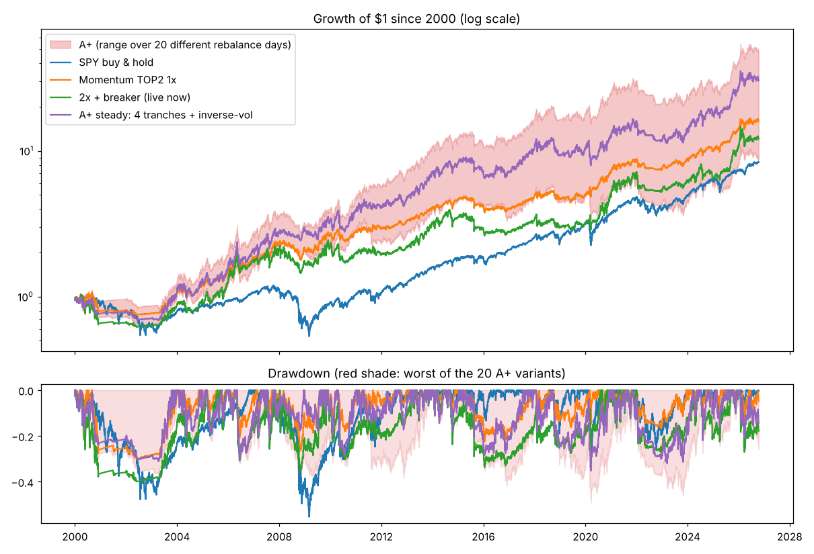

# Noire 研究报告 v2：有没有比 A+ 更好的方案（数据到 2026-10-14）

> 只做研究，不改实盘参数。所有数字是历史模拟（2000 年 1 月起），不代表未来。
> A+ = 动量轮动前 2 名，杠杆 = min(30% ÷ 当前持仓近 63 天波动, 趋势开关)，限制在 1~2 倍；趋势开关：SPY 前一天收盘在 200 日均线上方才允许超过 1 倍。
> 成本：单边 0.10%；借钱利率 = 13 周国库券利率 + 1.5%（另见 D 节）。

## 结论（Claude 写，2026-10-15 晚）

**一句话：试了约 60 种改法，没有找到“赚得明显更多、风险差不多”的方案。
唯一值得升级的是“A+ 稳健版”：平均收益和 A+ 一样，但回撤更小，而且不再靠“哪天换仓”的运气。**

为了公平，下面都用“7 个不同换仓日的平均”（2000 年至今）比较。这比只算“月末换仓”的数字低一些
（A+ 月末换仓是 14.6%，7 个换仓日平均是 13.6%），因为月末恰好是历史上运气较好的一天，将来不一定。

### 1. 主要方案对比（7 个换仓日平均，2000 至今）

| 方案 | 平均年化 | 年化范围（看换仓日运气） | 平均最大回撤 | 最坏最大回撤 | 平均最差一年 |
|---|---|---|---|---|---|
| 现在的 2 倍+熔断 | 8.8% | 6.7%~10.6% | -38.9% | -41.4% | -28.7% |
| A+ | 13.6% | 11.9%~15.0% | -39.0% | -42.3% | -26.6% |
| **A+ 稳健版** | **13.5%** | **13.2%~13.7%** | **-35.9%** | **-36.8%** | **-25.7%** |
| 1 倍（参考） | 10.1% | 8.7%~11.1% | -29.2% | -30.9% | -20.7% |

稳健版 = A+ 的杠杆控制（波动目标 30% + 趋势开关）再加两个改动：
- **分 4 批换仓**：资金分 4 份，分别在月末、月末前 5/10/15 个交易日换仓（大约每周动一份），不再押宝某一天。
- **波动小的多买**：选中的两只按“波动越小买越多”分配（例如 QQQ 配 TLT 时，TLT 多一些），两只承担的风险差不多。

这两个都是业内常用、有道理的做法，不是从数据里硬挑出来的：分批换仓专门消除“换仓日运气”，
按波动分配让两只资产承担相近的风险。

### 2. 试过但不更好的
- **扩大可选范围**（加中期国债、公司债、高收益债、房地产、大宗商品、9 个行业等 5 种组合）：全部比现行 7 只差
  （月末换仓、A+ 杠杆控制下年化 9.6%~13.6%，现行 7 只是 14.6%）。2022 年确实亏得少（大宗商品大涨），但其他年份选错的次数更多。
- **换动量算法**（13612W、除以波动）：13612W 明显更差。“前 3 名·除以波动·波动小的多买”平均略好（13.8%），
  但前半段比 A+ 差、后半段比 A+ 好（11.1%/16.3% 对 12.7%/14.6%），而且同样看换仓日运气（11.3%~15.0%），不够可靠。
- **持有全部趋势向上的资产**：加 A+ 杠杆控制后年化也只有 8.3%~9.2%。
- **更激进的杠杆**（波动目标 35%~50%）：年化只多 0.2~0.7 个百分点，平均最大回撤多 2~5 个百分点，不划算。A+ 的 30% 正好在拐点上。
- **金丝雀信号**（EEM 或中期国债走弱就降杠杆）：降杠杆太频繁，年化少 2 个多百分点。
- **每天跌破 200 日线就卖**：年化少 1 个百分点。
- **简单择时**（SPY 或 QQQ 在 200 日线上方才持有）：远不如动量轮动。

### 3. 用真钱时要注意的成本
- Alpaca 公布的保证金利率是 6.5%（Elite 用户 5%），比现在的国库券利率（约 4.1%）高约 2.5 个百分点，比研究默认的 1.5 个百分点高。
  按 2.5 个百分点算：A+ 平均年化从 13.6% 降到 12.9%，稳健版从 13.5% 降到 12.8%，仍明显好过 1 倍（10.1%）和现行设置（8.2%）。
- 模拟盘可能不收利息，所以模拟盘成绩会比真钱稍好。

### 4. 建议（等用户决定，研究不改实盘）
- **首选：A+ 稳健版**——收益不变，回撤更小，结果不靠运气。代价是程序复杂一些、每月多换几次仓（Alpaca 不收佣金，影响很小）。
- 想要最简单：A+。
- 两者都远好于现在的“2 倍+熔断”。无论选哪个都保留：单日亏损 5% 只卖不买、STOP 紧急停止、保证金和杠杆报警。
- 不建议继续在这套策略上“调参数”：试得越多，越容易找到只是碰巧好看的结果。

---

# 附：全部数据

## A. 现行 7 只 ETF：持有几只 × 怎么打分 × 怎么分配（月末换仓，2000 至今）

| 持有 | 打分 | 分配 | 1倍年化 | 1倍夏普 | A+年化 | A+最大回撤 | A+最差一年 | A+夏普 | 前半段年化(2000–12) | 后半段年化(2013–) |
|---|---|---|---|---|---|---|---|---|---|---|
| 前2名 | 1/3/6/12平均 | 平均分配 | 11.0% | 0.61 | 14.6% | -39.6% | -23.4% | 0.60 | 12.9% | 16.3% |
| 前2名 | 1/3/6/12平均 | 波动小的多买 | 11.5% | 0.66 | 15.1% | -37.5% | -23.2% | 0.62 | 14.6% | 15.6% |
| 前2名 | 13612W | 平均分配 | 9.7% | 0.55 | 12.5% | -46.0% | -37.9% | 0.53 | 14.6% | 10.5% |
| 前2名 | 13612W | 波动小的多买 | 9.1% | 0.53 | 11.7% | -46.2% | -36.7% | 0.51 | 13.2% | 10.4% |
| 前2名 | 除以波动 | 平均分配 | 10.1% | 0.58 | 13.3% | -39.9% | -23.4% | 0.57 | 11.9% | 14.8% |
| 前2名 | 除以波动 | 波动小的多买 | 10.2% | 0.62 | 13.5% | -38.0% | -23.2% | 0.58 | 12.0% | 14.9% |
| 前3名 | 1/3/6/12平均 | 平均分配 | 10.3% | 0.64 | 13.4% | -37.3% | -30.2% | 0.59 | 12.1% | 14.7% |
| 前3名 | 1/3/6/12平均 | 波动小的多买 | 10.5% | 0.67 | 13.8% | -35.5% | -28.1% | 0.61 | 12.6% | 14.9% |
| 前3名 | 13612W | 平均分配 | 9.1% | 0.57 | 11.4% | -37.8% | -29.5% | 0.51 | 11.3% | 11.4% |
| 前3名 | 13612W | 波动小的多买 | 9.2% | 0.60 | 11.8% | -37.4% | -28.2% | 0.54 | 10.7% | 13.0% |
| 前3名 | 除以波动 | 平均分配 | 10.6% | 0.68 | 14.5% | -34.9% | -26.2% | 0.64 | 13.0% | 15.9% |
| 前3名 | 除以波动 | 波动小的多买 | 10.7% | 0.71 | 14.6% | -34.2% | -24.7% | 0.65 | 12.8% | 16.3% |
| 全部向上的 | 1/3/6/12平均 | 平均分配 | 6.6% | 0.46 | 8.7% | -34.3% | -24.3% | 0.44 | 7.8% | 9.5% |
| 全部向上的 | 1/3/6/12平均 | 波动小的多买 | 6.9% | 0.52 | 9.2% | -32.2% | -21.8% | 0.49 | 8.3% | 10.0% |
| 全部向上的 | 13612W | 平均分配 | 6.4% | 0.46 | 8.6% | -31.2% | -19.6% | 0.45 | 9.8% | 7.5% |
| 全部向上的 | 13612W | 波动小的多买 | 6.0% | 0.45 | 8.3% | -33.6% | -19.2% | 0.45 | 8.6% | 7.9% |
| 全部向上的 | 除以波动 | 平均分配 | 6.6% | 0.46 | 8.7% | -34.3% | -24.3% | 0.44 | 7.8% | 9.5% |
| 全部向上的 | 除以波动 | 波动小的多买 | 6.9% | 0.52 | 9.2% | -32.2% | -21.8% | 0.49 | 8.3% | 10.0% |

## B. 扩大可选范围（月末换仓，A+ 杠杆控制，2000 至今；新 ETF 上市满 13 个月后才参与）

| 可选范围 | 方案 | 1倍年化 | A+年化 | A+最大回撤 | A+夏普 | 前半段年化 | 后半段年化 | 金融危机 | 2022年 |
|---|---|---|---|---|---|---|---|---|---|
| 现行 7 只 | 前2名·平均分配 | 11.0% | 14.6% | -39.6% | 0.60 | 12.9% | 16.3% | -9.4% | -23.5% |
| 现行 7 只 | 前2名·波动小的多买 | 11.5% | 15.1% | -37.5% | 0.62 | 14.6% | 15.6% | 8.8% | -24.1% |
| 现行 7 只 | 前3名·平均分配 | 10.3% | 13.4% | -37.3% | 0.59 | 12.1% | 14.7% | -11.5% | -27.1% |
| 现行 7 只 | 前3名·波动小的多买 | 10.5% | 13.8% | -35.5% | 0.61 | 12.6% | 14.9% | -2.5% | -25.5% |
| 多资产 12 只（+中期国债、公司债、高收益债、房地产、大宗商品） | 前2名·平均分配 | 9.8% | 13.2% | -48.4% | 0.54 | 13.2% | 13.2% | 19.0% | -6.3% |
| 多资产 12 只（+中期国债、公司债、高收益债、房地产、大宗商品） | 前2名·波动小的多买 | 9.9% | 13.5% | -45.5% | 0.56 | 14.3% | 12.9% | 29.0% | -9.1% |
| 多资产 12 只（+中期国债、公司债、高收益债、房地产、大宗商品） | 前3名·平均分配 | 9.8% | 13.1% | -40.5% | 0.57 | 13.2% | 13.1% | 6.6% | -9.4% |
| 多资产 12 只（+中期国债、公司债、高收益债、房地产、大宗商品） | 前3名·波动小的多买 | 10.0% | 13.6% | -39.3% | 0.60 | 14.2% | 13.0% | 24.6% | -12.1% |
| Keller G12（另一套常见的 12 只） | 前2名·平均分配 | 9.5% | 12.1% | -45.1% | 0.50 | 11.3% | 12.8% | 9.9% | -6.0% |
| Keller G12（另一套常见的 12 只） | 前2名·波动小的多买 | 9.2% | 11.6% | -45.5% | 0.49 | 11.3% | 11.9% | 26.5% | -9.0% |
| Keller G12（另一套常见的 12 只） | 前3名·平均分配 | 9.4% | 11.9% | -39.2% | 0.52 | 10.6% | 13.2% | 1.8% | -9.1% |
| Keller G12（另一套常见的 12 只） | 前3名·波动小的多买 | 9.5% | 11.8% | -37.5% | 0.52 | 10.6% | 13.0% | 18.4% | -12.1% |
| 现行 7 只 + 9 个行业 | 前2名·平均分配 | 8.6% | 10.2% | -43.6% | 0.43 | 9.0% | 11.4% | -15.7% | 13.1% |
| 现行 7 只 + 9 个行业 | 前2名·波动小的多买 | 8.4% | 10.1% | -46.7% | 0.42 | 9.5% | 10.7% | -6.2% | 5.3% |
| 现行 7 只 + 9 个行业 | 前3名·平均分配 | 9.5% | 11.7% | -43.9% | 0.49 | 8.5% | 14.8% | -13.9% | 0.2% |
| 现行 7 只 + 9 个行业 | 前3名·波动小的多买 | 9.1% | 11.3% | -46.0% | 0.48 | 8.7% | 13.8% | -3.1% | -8.5% |
| 多资产 12 只 + 9 个行业 | 前2名·平均分配 | 8.8% | 9.8% | -46.8% | 0.41 | 11.4% | 8.2% | 13.3% | 4.8% |
| 多资产 12 只 + 9 个行业 | 前2名·波动小的多买 | 8.6% | 9.6% | -47.4% | 0.40 | 11.3% | 7.9% | 20.3% | 2.2% |
| 多资产 12 只 + 9 个行业 | 前3名·平均分配 | 9.0% | 11.3% | -45.2% | 0.47 | 9.4% | 13.1% | 0.8% | 5.2% |
| 多资产 12 只 + 9 个行业 | 前3名·波动小的多买 | 8.6% | 11.0% | -43.4% | 0.47 | 9.8% | 12.2% | 15.9% | -2.5% |

## C. 杠杆控制的其他做法（前 2 名，2000 至今）

只在一个换仓日换仓的方案：在 20 个不同换仓日（月末、月末前第 1~19 个交易日）下各算一遍；分 4 批的方案：在 5 种分批方式（月末前第 p、p+5、p+10、p+15 个交易日，p=0~4）下各算一遍。表里是平均值，“最低/最高年化”是其中最差和最好的那个；差得越多，说明运气成分越大。

| 方案 | 平均年化 | 最低年化 | 最高年化 | 平均最大回撤 | 最坏最大回撤 | 平均最差一年 | 夏普 | 平均杠杆 | 前半段年化 | 后半段年化 | 成本翻倍年化 |
|---|---|---|---|---|---|---|---|---|---|---|---|
| 1倍 | 9.7% | 6.6% | 11.7% | -30.6% | -37.9% | -20.3% | 0.54 | 1.00 | 9.3% | 10.0% | 8.9% |
| 2倍+熔断（原来的） | 8.3% | 5.3% | 10.6% | -40.0% | -45.3% | -28.0% | 0.38 | 1.37 | 7.2% | 9.8% | 7.5% |
| A：波动目标 25% | 12.1% | 7.6% | 14.6% | -43.2% | -49.6% | -29.8% | 0.51 | 1.68 | 11.5% | 12.6% | 10.4% |
| A+：波动目标 30% + 趋势开关 | 12.8% | 8.4% | 15.6% | -40.9% | -49.1% | -26.7% | 0.53 | 1.68 | 12.2% | 13.5% | 10.8% |
| A+ 不借钱买现金 | 12.8% | 8.4% | 15.6% | -40.9% | -49.1% | -26.5% | 0.53 | 1.68 | 12.2% | 13.5% | 10.8% |
| A+ 波动小的多买 | 13.2% | 8.8% | 16.2% | -41.0% | -50.1% | -25.6% | 0.55 | 1.70 | 12.9% | 13.5% | 11.0% |
| A+ 分 4 批换仓 | 12.8% | 12.0% | 13.4% | -38.6% | -41.7% | -27.0% | 0.54 | 1.67 | 12.1% | 13.4% | 10.8% |
| A+ 稳健版：分 4 批 + 波动小的多买（实盘） | 13.1% | 12.5% | 13.7% | -39.3% | -42.3% | -26.0% | 0.56 | 1.69 | 12.8% | 13.4% | 10.9% |
| A+ 前 3 名·除以波动·波动小的多买 | 13.3% | 10.4% | 15.0% | -36.1% | -42.3% | -25.4% | 0.60 | 1.76 | 11.2% | 15.4% | 11.4% |
| A+ 每日跌破 200 日线就离场 | 11.9% | 8.1% | 14.4% | -41.6% | -52.9% | -25.2% | 0.51 | 1.70 | 11.2% | 12.6% | 9.1% |
| 波动目标 30% + 金丝雀 | 10.7% | 7.4% | 13.4% | -38.6% | -54.6% | -22.6% | 0.49 | 1.39 | 10.1% | 11.2% | 7.8% |
| 波动目标 30% + 趋势 + 金丝雀 | 10.8% | 7.7% | 13.6% | -35.1% | -45.4% | -22.4% | 0.51 | 1.34 | 10.4% | 11.2% | 8.0% |
| 波动目标 35% + 趋势 | 13.0% | 8.1% | 16.1% | -43.3% | -52.3% | -28.7% | 0.53 | 1.74 | 12.7% | 13.3% | 10.9% |
| 波动目标 40% + 趋势 | 13.1% | 8.0% | 16.5% | -44.3% | -53.8% | -29.2% | 0.52 | 1.77 | 12.8% | 13.5% | 11.0% |
| 波动目标 50% + 趋势 | 13.4% | 7.9% | 17.1% | -45.8% | -55.2% | -30.6% | 0.52 | 1.80 | 13.1% | 13.8% | 11.2% |
| 只用趋势开关（2 倍/1 倍） | 12.8% | 7.4% | 16.8% | -49.8% | -59.6% | -37.1% | 0.50 | 1.82 | 11.8% | 13.9% | 10.6% |

## D. 借钱利率敏感性（平均年化，算法同 C 节）

Alpaca 公布的保证金利率：普通用户 6.50%、Elite 5.00%（按 360 天计息）；现在 13 周国库券约 4.1%，所以利差约 2.5 个百分点。模拟盘可能不收利息，所以模拟盘成绩会比真钱好一点。

| 方案 | 利差 1.5%（基准） | 利差 2.5%（≈Alpaca 现价） | 利差 3.5% |
|---|---|---|---|
| 1倍 | 9.7% | 9.7% | 9.7% |
| 2倍+熔断（原来的） | 8.3% | 7.8% | 7.6% |
| A：波动目标 25% | 12.1% | 11.4% | 10.7% |
| A+：波动目标 30% + 趋势开关 | 12.8% | 12.1% | 11.5% |
| A+ 不借钱买现金 | 12.8% | 12.1% | 11.5% |
| A+ 波动小的多买 | 13.2% | 12.5% | 11.8% |
| A+ 分 4 批换仓 | 12.8% | 12.1% | 11.4% |
| A+ 稳健版：分 4 批 + 波动小的多买（实盘） | 13.1% | 12.3% | 11.6% |
| A+ 前 3 名·除以波动·波动小的多买 | 13.3% | 12.5% | 11.8% |
| A+ 每日跌破 200 日线就离场 | 11.9% | 11.2% | 10.5% |
| 波动目标 30% + 金丝雀 | 10.7% | 10.3% | 9.9% |
| 波动目标 30% + 趋势 + 金丝雀 | 10.8% | 10.4% | 10.1% |
| 波动目标 35% + 趋势 | 13.0% | 12.2% | 11.5% |
| 波动目标 40% + 趋势 | 13.1% | 12.3% | 11.6% |
| 波动目标 50% + 趋势 | 13.4% | 12.6% | 11.8% |
| 只用趋势开关（2 倍/1 倍） | 12.8% | 12.0% | 11.2% |

## E. 和简单择时比较（月末换仓，2000 至今）

| 策略 | 杠杆 | 年化 | 最大回撤 | 最差一年 | 夏普 |
|---|---|---|---|---|---|
| 动量轮动前 2 名（现行） | 1 倍 | 11.0% | -29.9% | -19.1% | 0.61 |
| 动量轮动前 2 名（现行） | A+ | 14.6% | -39.6% | -23.4% | 0.60 |
| SPY 200 日线择时 | 1 倍 | 5.7% | -26.1% | -17.5% | 0.37 |
| SPY 200 日线择时 | A+ | 7.9% | -38.7% | -26.1% | 0.38 |
| QQQ 200 日线择时 | 1 倍 | 7.4% | -52.1% | -21.1% | 0.39 |
| QQQ 200 日线择时 | A+ | 10.1% | -54.4% | -25.4% | 0.43 |
| 一半轮动 + 一半 SPY 择时 | 1 倍 | 8.5% | -24.3% | -16.3% | 0.56 |
| 一半轮动 + 一半 SPY 择时 | A+ | 11.1% | -37.9% | -25.7% | 0.51 |

